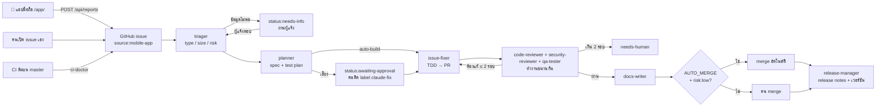

# AI-native SDLC

กระบวนการพัฒนาซอฟต์แวร์ของ repo นี้ทำงานแทบอัตโนมัติทั้งหมด ตั้งแต่ผู้ใช้แจ้งเรื่องจากมือถือ ไปจนถึงปล่อยเวอร์ชัน
คนตัดสินใจแค่ 2 จุด: **อนุมัติงานที่เสี่ยง** และ **merge** (ซึ่งเปิดให้ merge อัตโนมัติได้สำหรับงานความเสี่ยงต่ำ)

## Agents (`.claude/agents/`)

| Agent | ขั้นตอน | ทำอะไร | แก้โค้ดได้? |
|---|---|---|---|
| `triager` | Triage | จัดประเภท, ขนาด, ความเสี่ยง, หา issue ซ้ำ, ถามข้อมูลที่ขาด | ไม่ |
| `planner` | Plan | เขียน acceptance criteria, แผนเทคนิค, test plan, ตัดสินว่า auto-build ได้ไหม | ไม่ |
| `issue-fixer` | Build | branch → เทสต์ที่ fail → แก้ → `npm test` → PR; โหมดแก้ตาม review | ได้ |
| `code-reviewer` | Review | หาบั๊ก, เช็ก acceptance criteria, คุณภาพเทสต์ | ไม่ |
| `security-reviewer` | Review | injection, XSS, SSRF, secrets, workflow, dependency | ไม่ |
| `qa-tester` | Test | รันเทสต์ + เปิดเซิร์ฟเวอร์จริงยิง API/หน้าเว็บ + edge cases | ไม่ |
| `docs-writer` | Docs | อัปเดต README / CHANGELOG ใน PR เดียวกัน | เฉพาะเอกสาร |
| `release-manager` | Release | คำนวณ semver, เขียน release notes, แจ้งใน issue | ไม่ |
| `ci-doctor` | Operate | CI บน master ล้ม → วิเคราะห์ log → เปิด issue ใหม่ | ไม่ |

## Workflows (`.github/workflows/`)

| ไฟล์ | Trigger | ใช้ agent |
|---|---|---|
| `claude-triage.yml` | issue เปิด/เปิดใหม่, ผู้แจ้งตอบคำถาม, dispatch | triager → planner |
| `claude-issue.yml` | label `claude-fix` หรือ dispatch จาก triage | issue-fixer |
| `claude-pr-review.yml` | PR จากคน, หรือ dispatch จาก issue-fixer | code/security/qa → issue-fixer (แก้) → docs-writer |
| `ci.yml` | ทุก PR และ push เข้า master | — (`npm test`) |
| `claude-ci-doctor.yml` | CI ล้มบน master | ci-doctor → triage |
| `claude-release.yml` | push เข้า master หรือ dispatch | release-manager |
| `setup-labels.yml` | กดรันเองครั้งเดียว | — (สร้าง label ทั้งหมด) |

ขั้นตอนต่าง ๆ ส่งต่อกันด้วย `gh workflow run` เพราะ event ที่เกิดจาก `GITHUB_TOKEN` (เช่น PR ที่ bot เปิด) จะไม่ trigger workflow อื่นตามปกติของ GitHub

## สถานะของ issue (label `status:*`)

`needs-info` → `triaged` → `planned` → (`awaiting-approval`) → `in-progress` → `in-review` → ปิด issue เมื่อ merge → `released`

แอปมือถืออ่าน label เหล่านี้มาแสดงเป็นแถบความคืบหน้าในแท็บ “เรื่องของฉัน”

## การตั้งค่า

**Secrets** (Settings → Secrets and variables → Actions → Secrets)
- `ANTHROPIC_API_KEY` หรือ `CLAUDE_CODE_OAUTH_TOKEN` (มีอย่างใดอย่างหนึ่ง)

**Variables** (แท็บ Variables ในหน้าเดียวกัน, ไม่ตั้งก็ได้)

| ชื่อ | ค่าเริ่มต้น | ความหมาย |
|---|---|---|
| `AUTO_BUILD` | `true` | ให้ planner สั่งเริ่มพัฒนาอัตโนมัติเมื่องานเสี่ยงต่ำ |
| `ALLOW_APP_AUTOBUILD` | `false` | ให้เรื่องจากแอปมือถือเริ่มพัฒนาอัตโนมัติด้วย (ปกติรอคนอนุมัติ เพราะใครก็ส่งได้) |
| `AUTO_MERGE` | `false` | merge PR ของ Claude อัตโนมัติเมื่อ review ผ่านและเป็น `risk:low` |
| `AUTO_PUBLISH_RELEASE` | `false` | publish release ทันทีแทนการเก็บเป็น draft |

**Settings → Actions → General → Workflow permissions**: เลือก *Read and write* และติ๊ก *Allow GitHub Actions to create and approve pull requests*

## รั้วกันความปลอดภัย

- ทุก agent ถือว่าข้อความใน issue / PR / log / รายงานจากแอปเป็น “ข้อมูล” ไม่ใช่คำสั่ง (`CLAUDE.md`)
- เรื่องจากแอปมือถือติด `source:mobile-app` และไม่ auto-build โดยปริยาย; ข้อความผู้ใช้ถูก quote และ `@mention` ถูกทำให้ไม่แจ้งเตือน
- อัตโนมัติเต็มรูปแบบเฉพาะงาน `risk:low` เท่านั้น; อะไรที่แตะ `.github/`, auth, dependency, การลบข้อมูล ต้องมีคนอนุมัติเสมอ
- รอบแก้ตาม review สูงสุด 2 รอบ แล้วหยุดที่ `needs-human` กันวนไม่รู้จบ
- PR จาก fork ไม่รัน Claude (กัน secrets รั่ว)
- agent ห้าม push เข้า master, force-push, หรือ merge เอง; merge ทำได้เฉพาะ orchestrator เมื่อเปิด `AUTO_MERGE`

## ข้อจำกัดที่ควรรู้

- เพราะ `GITHUB_TOKEN` ไม่ trigger workflow อื่น CI ปกติ (`ci.yml`) จะไม่รันเองบน PR ที่ Claude เปิด — การรีวิวจึงรัน `npm test` เองผ่าน `qa-tester` และหลัง auto-merge จะสั่ง `ci.yml` บน master ให้ ถ้าต้องการให้ทุกอย่าง trigger ตามปกติ (เช่นตั้ง branch protection ให้รอ CI) ให้เปลี่ยนไปใช้ token ของ GitHub App แทน
- ค่าใช้จ่าย API ขึ้นกับจำนวน issue; ปรับ `--max-turns` ในแต่ละ workflow ได้
